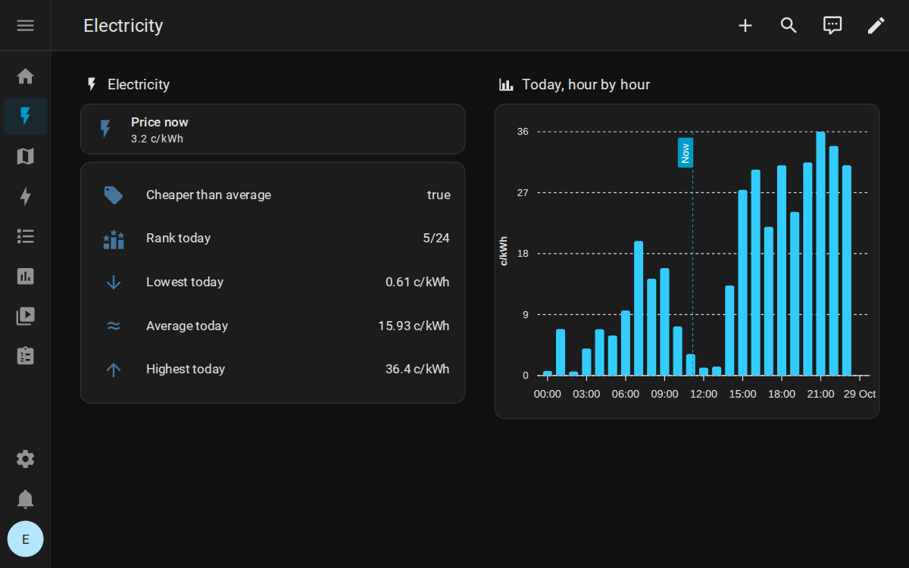

<div align="center">
  

  # Elering Estonia Electricity Price

  [](https://github.com/hacs/integration)
  [](https://github.com/Gren-95/ha-elering-ee/releases)
  [](LICENSE)

  Estonian electricity prices in Home Assistant: Nord Pool spot prices from Elering's public API, with VAT and your network fees added.
</div>

<p align="center">
  
</p>

---

## Features

- The current price, updated every hour, in c/kWh or EUR/kWh
- Estonian VAT (22%) added by default, plus any network fees you enter
- All of today's hourly prices, and tomorrow's once they are published (around 14:00)
- No API key: Elering's price API is public
- Set up and changed from the Home Assistant UI

### Attributes

- `is_cheap`: whether the current price is below today's average
- `price_percent_to_average`: the current price as a percentage of today's average
- `price_rank`: where the current hour ranks today, e.g. `5/24` is the fifth cheapest
- `min`, `max`, `average`, `median`: today's statistics, and the same for tomorrow
- `peak_average`, `off_peak_average`: averages for 07:00-23:00 and the rest of the day
- The hourly price lists are kept out of the recorder database, so they don't bloat it

## Installation

### Option 1: HACS

1. In HACS, open the menu (top right) and choose **Custom repositories**
2. Add `https://github.com/Gren-95/ha-elering-ee` with the type **Integration**
3. Find **Elering Estonia Electricity Price** in HACS and download it

### Option 2: Manual installation

Copy `custom_components/elering_ee` from this repository into your Home Assistant `config/custom_components/` directory, so you end up with `config/custom_components/elering_ee/manifest.json`

### Set up

1. Restart Home Assistant

2. Go to **Settings** → **Devices & Services** → **Add Integration**

3. Search for "Elering Estonia" and configure:
   - **VAT rate**: 0.22 (22%, default for Estonia)
   - **Price in cents**: Yes (shows c/kWh) or No (shows EUR/kWh, which the Energy dashboard needs)
   - **Additional costs**: Any fixed costs in EUR/MWh (e.g., network fees)
   - **Precision**: Number of decimal places (default: 2)

### YAML configuration (legacy)

You can still use YAML, but UI configuration is recommended:

```yaml
sensor:
  - platform: elering_ee
```

Then configure via UI as described above.

## Configuration

### Settings Explained

| Setting | Default | Description |
|---------|---------|-------------|
| **VAT** | 0.22 (22%) | Estonia's VAT rate on electricity |
| **Price in cents** | Yes | Show price as c/kWh (easier to read) vs EUR/kWh (Energy dashboard) |
| **Additional costs** | 0.0 | Add network fees or other charges (in EUR/MWh) |
| **Precision** | 2 | Decimal places to display |

### Example Configurations

**Home user with network fees:**
- VAT: 0.22
- Price in cents: Yes
- Additional costs: 35.0 (EUR/MWh network fee)
- Result: ~12.5 c/kWh (spot price + VAT + network fee)

**Business user without VAT:**
- VAT: 0.0
- Price in cents: No
- Additional costs: 0.0
- Precision: 4
- Result: Shows the spot price in EUR/kWh, ready for the Energy dashboard

## Usage

### Sensor Entity

After setup, you'll have: `sensor.electricity_price`

**State**: Current electricity price (in c/kWh or EUR/kWh based on config)

### Available Attributes

```yaml
# Price Intelligence
is_cheap: true                      # Is price below average?
price_percent_to_average: 87.3      # Current price vs daily average
price_rank: "5/24"                  # 5th cheapest hour of the day

# Statistics - Today
average: 12.45                      # Average price today
min: 8.32                          # Minimum price today
max: 18.67                         # Maximum price today
median: 11.98                      # Median price today
peak_average: 13.21                # Average during peak hours (7-23)
off_peak_average: 9.87             # Average during off-peak (23-7)

# Statistics - Tomorrow
tomorrow_valid: true               # Are tomorrow's prices available?
average_tomorrow: 11.23            # Average price tomorrow
min_tomorrow: 7.45                # Minimum price tomorrow
max_tomorrow: 16.34               # Maximum price tomorrow

# Price Arrays
prices_today:                      # Hourly prices for today
  - time: "00:00"
    price: 9.32
  - time: "01:00"
    price: 8.87
  # ... (24 hours)

prices_tomorrow:                   # Hourly prices for tomorrow
  - time: "00:00"
    price: 10.12
  # ... (24 hours, available after ~13:00)

# Configuration Info
vat_rate: 0.22
additional_costs: 35.0
unit: "c/kWh"
currency: "EUR"
last_updated: "2024-01-15T14:30:00"
```

## Examples

Automations and dashboard cards are in [EXAMPLES.md](EXAMPLES.md):

- Automations: [notify when electricity is cheap](EXAMPLES.md#notify-when-electricity-is-cheap), [run the dishwasher in the cheapest hours](EXAMPLES.md#run-dishwasher-during-cheapest-hours), [charge an EV in the cheapest night hours](EXAMPLES.md#charge-ev-during-cheapest-night-hours), [a daily price summary](EXAMPLES.md#daily-price-summary-notification)
- Dashboard cards: [a simple entity card](EXAMPLES.md#simple-entity-card), [a statistics card](EXAMPLES.md#detailed-statistics-card), [an hourly price chart](EXAMPLES.md#apex-charts-card-requires-custom-card) (needs the ApexCharts card)

## Technical Details

### Data Source
- **API**: Elering (Estonian TSO) - https://dashboard.elering.ee/api/nps/price
- **Data**: Nord Pool spot prices for Estonia (EE price zone)
- **Update frequency**: Every hour
- **API Key**: Not required (public API)

### Price Calculation

```
Final Price = (Spot Price × (1 + VAT)) + Additional Costs
```

Then it is converted to the configured unit:
```
Final Price (EUR/kWh) = Final Price (EUR/MWh) / 1000
Final Price (c/kWh)   = Final Price (EUR/MWh) / 10
```

Example:
- Spot price: 100 EUR/MWh
- VAT: 22% (0.22)
- Additional costs: 35 EUR/MWh
- Result: (100 × 1.22) + 35 = 157 EUR/MWh = 15.7 c/kWh

### Data Retention
Large price arrays (`prices_today`, `prices_tomorrow`, `raw_today`, `raw_tomorrow`) are excluded from the Home Assistant database to save space while remaining accessible via attributes.

## Troubleshooting

### Prices not updating
- Check Home Assistant logs for errors
- Verify internet connection
- Elering API may be temporarily unavailable

### Tomorrow's prices not available
- Tomorrow's prices are published around 13:00-14:00 CET
- Before that time, `tomorrow_valid` will be `false`

### Using the Energy dashboard
- The Energy dashboard only accepts a price in EUR/kWh: turn **Price in cents** off in the integration's options

### Incorrect prices
- Verify VAT rate (Estonia: 22%)
- Check additional costs configuration
- Ensure correct unit selection (c/kWh vs EUR/kWh)
- With EUR/kWh, use a precision of 4 or more: at 2 decimals every price rounds to whole cents

## Support & Contributing

- **Issues**: Please report bugs or feature requests on GitHub
- **Data source**: Elering API documentation
- **License**: MIT

## Credits

Data provided by Elering (Estonian TSO) via their public API.
